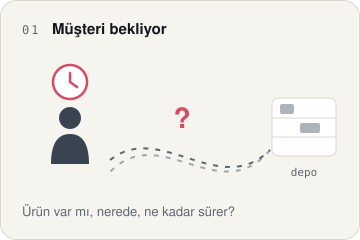
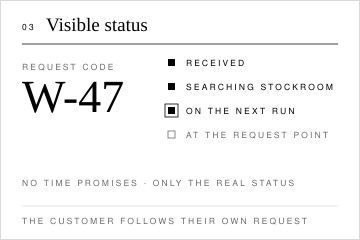

<picture>
  <source media="(prefers-color-scheme: dark)" srcset="assets/afis-dark.svg">
  <source media="(prefers-color-scheme: light)" srcset="assets/afis-light.svg">
  
</picture>

Hi, I'm Sude.

I'm a co-founder of **OpOne**. Together we're building four products that bring the entire operation of hotels, clinics and brands onto one platform: **DentAI**, **HotelAI**, **SocialAI** and **AgentAI**. I work on every layer, from the direction of the product down to the smallest rule on the screen.

<a href="https://sudegulcetinkaya-hub.github.io"><b>Live showcase</b></a> — the mascots follow your cursor and light up when you tap them.

 

<table>
<tr>
<td align="center" width="50%" valign="top">
 
<b>HelloDentAI</b> 
dental clinics  
The whole clinic flow in one place, from booking to payment. Patients get answers in their own language: consent first, then the reply.  
<a href="https://hellodentai.com">hellodentai.com</a> · <a href="https://www.instagram.com/hellodentai.io/">Instagram</a>
</td>
<td align="center" width="50%" valign="top">
 
<b>HelloHotelAI</b> 
hospitality  
The whole hotel on one screen, from the front desk to housekeeping. Guest messages and the day's work in a single flow.  
<a href="https://hellohotelai.com">hellohotelai.com</a> · <a href="https://www.instagram.com/hellohotelai.io/">Instagram</a>
</td>
</tr>
<tr>
<td align="center" width="50%" valign="top">
 
<b>HelloSocialAI</b> 
content and ads  
Your brand's voice, every day and on every channel. Content calendar, posting and ad management in one team.  
<a href="https://www.instagram.com/hellosocialai.io/">Instagram</a>
</td>
<td align="center" width="50%" valign="top">
 
<b>HelloAgentAI</b> 
digital team  
Teammates that take a task, finish it and show the proof. They plan, build and report.  
<a href="https://www.instagram.com/helloagentai.io/">Instagram</a>
</td>
</tr>
</table>

### My project: Request Point

fashion retail experience · prototype

The longest minutes in a store are the ones a customer spends waiting for their size to come up from the stockroom. Is it in stock, where is it, has the request been forgotten? None of it is visible. Request Point makes that wait visible. The customer leaves a request, gets a short request code (**W-47**) and follows each step on their own: *received, searching the stockroom, on the next run, at the request point*. The sales associate sees the same record in a single list. Nobody asks the same question twice, and nobody goes down to the stockroom twice for the same item.

There are no time promises on the screen, only the real status. A "10 minutes" that doesn't hold costs more trust than no promise at all.

<table>
<tr>
<td align="center" width="33%" valign="top">
<picture>
  <source media="(prefers-color-scheme: dark)" srcset="assets/vaka/kare-1-dark.svg">
  <source media="(prefers-color-scheme: light)" srcset="assets/vaka/kare-1-light.svg">
  
</picture> 
<b>1 · The wait</b>
</td>
<td align="center" width="33%" valign="top">
<picture>
  <source media="(prefers-color-scheme: dark)" srcset="assets/vaka/kare-2-dark.svg">
  <source media="(prefers-color-scheme: light)" srcset="assets/vaka/kare-2-light.svg">
  
</picture> 
<b>2 · One record</b>
</td>
<td align="center" width="33%" valign="top">
<picture>
  <source media="(prefers-color-scheme: dark)" srcset="assets/vaka/kare-3-dark.svg">
  <source media="(prefers-color-scheme: light)" srcset="assets/vaka/kare-3-light.svg">
  
</picture> 
<b>3 · Visible status</b>
</td>
</tr>
</table>

<b>What I learned:</b> What reassures a waiting customer most isn't speed. It's being able to see where their request is.

<a href="https://sudegulcetinkaya-hub.github.io/istek-noktasi-acik/">Live prototype</a> · <a href="https://github.com/sudegulcetinkaya-hub/istek-noktasi-acik">Code</a>

### Right now

- **Clinic panel** — one-click booking from the calendar, a screen that adapts to each person, the right date even at midnight.
- **The Hello mascot family** — eyes that follow the cursor, little faces that light up when tapped.
- **Sales desk** — a 12-slide deck for clinics and a live demo in four languages.

<code>HTML</code> · <code>CSS</code> · <code>JavaScript</code> · <code>Node.js</code> · <code>Python</code> · <code>Playwright</code>

 

<a href="https://hellopone.com">hellopone.com</a> · <a href="https://www.instagram.com/helloponeai/">@helloponeai</a> · <a href="https://github.com/opone-ai">github.com/opone-ai</a>

