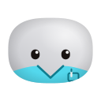
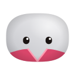
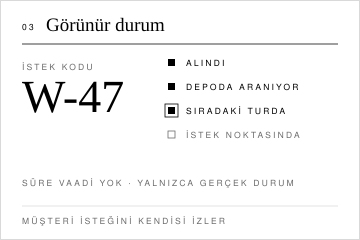

<a href="https://github.com/sudegulcetinkaya-hub">English</a> · <b>Türkçe</b>

<picture>
  <source media="(prefers-color-scheme: dark)" srcset="assets/tr/afis-dark.svg">
  <source media="(prefers-color-scheme: light)" srcset="assets/tr/afis-light.svg">
  
</picture>

Merhaba, ben Sude.

**OpOne**'ın kurucu ortağıyım. Otellerin, kliniklerin ve markaların bütün operasyonunu tek platformda toplayan dört ürünü birlikte kuruyoruz: **DentAI**, **HotelAI**, **SocialAI** ve **AgentAI**. Ürünün yönünden ekrandaki en küçük kurala kadar her katmanda çalışıyorum.

<a href="https://sudegulcetinkaya-hub.github.io"><b>Canlı vitrin</b></a>: maskotlar imleci izler, dokununca sevinir.

 

<table>
<tr>
<td align="center" width="50%" valign="top">
 
<b>HelloDentAI</b> 
diş klinikleri  
Randevudan tahsilata klinik akışı tek yerde. Hastaya kendi dilinde cevap; önce rıza, sonra cevap.  
<a href="https://hellodentai.com">hellodentai.com</a> · <a href="https://www.instagram.com/hellodentai.io/">Instagram</a>
</td>
<td align="center" width="50%" valign="top">
 
<b>HelloHotelAI</b> 
konaklama  
Resepsiyondan kat hizmetlerine bütün otel aynı ekranda. Misafir mesajları ve günün işleri tek akışta.  
<a href="https://hellohotelai.com">hellohotelai.com</a> · <a href="https://www.instagram.com/hellohotelai.io/">Instagram</a>
</td>
</tr>
<tr>
<td align="center" width="50%" valign="top">
 
<b>HelloSocialAI</b> 
içerik ve reklam  
Markanın sesi, her gün ve her kanalda. İçerik takvimi, paylaşım ve reklam yönetimi tek ekipte.  
<a href="https://www.instagram.com/hellosocialai.io/">Instagram</a>
</td>
<td align="center" width="50%" valign="top">
 
<b>HelloAgentAI</b> 
dijital ekip  
Görevi alan, bitiren ve kanıtını sunan çalışma arkadaşları. Planlar, uygular, raporlar.  
<a href="https://www.instagram.com/helloagentai.io/">Instagram</a>
</td>
</tr>
</table>

### Diğer projem: İstek Noktası

moda mağazası deneyimi · prototip

Mağazada en uzun dakikalar, müşterinin istediği bedenin depodan gelmesini beklediği dakikalardır. Ürün var mı, nerede, isteği unutuldu mu: bunların hiçbiri görünmez. İstek Noktası bu bekleyişi görünür kılıyor. Müşteri isteğini bırakır, kısa bir istek kodu alır (**W-47**) ve isteğinin hangi adımda olduğunu kendisi izler: *alındı, depoda aranıyor, sıradaki turda, istek noktasında*. Danışman aynı kaydı tek listede görür. Kimse aynı soruyu iki kez sormaz, kimse depoya aynı ürün için iki kez inmez.

Ekranda saat ya da dakika vaadi yok; yalnızca gerçek durum var. Tutmayan bir "10 dakika" sözü, hiç söz vermemekten daha çok güven kaybettirir.

<table>
<tr>
<td align="center" width="33%" valign="top">
<picture>
  <source media="(prefers-color-scheme: dark)" srcset="assets/tr/vaka/kare-1-dark.svg">
  <source media="(prefers-color-scheme: light)" srcset="assets/tr/vaka/kare-1-light.svg">
  
</picture> 
<b>1 · Bekleyiş</b>
</td>
<td align="center" width="33%" valign="top">
<picture>
  <source media="(prefers-color-scheme: dark)" srcset="assets/tr/vaka/kare-2-dark.svg">
  <source media="(prefers-color-scheme: light)" srcset="assets/tr/vaka/kare-2-light.svg">
  
</picture> 
<b>2 · Tek kayıt</b>
</td>
<td align="center" width="33%" valign="top">
<picture>
  <source media="(prefers-color-scheme: dark)" srcset="assets/tr/vaka/kare-3-dark.svg">
  <source media="(prefers-color-scheme: light)" srcset="assets/tr/vaka/kare-3-light.svg">
  
</picture> 
<b>3 · Görünür durum</b>
</td>
</tr>
</table>

<b>Ne öğrendim:</b> Bekleyen müşteriyi en çok rahatlatan şey hız değil, isteğinin nerede olduğunu görebilmesi.

<a href="https://sudegulcetinkaya-hub.github.io/istek-noktasi-acik/">Canlı prototip</a> · <a href="https://github.com/sudegulcetinkaya-hub/istek-noktasi-acik">Kod</a>

### Şu sıralar

- **Klinik paneli**: takvimden tek tıkla randevu, kişiye göre düzenlenen ekran, gece yarısında bile doğru gün.
- **Hello maskot ailesi**: imleci izleyen gözler, dokununca sevinen küçük yüzler.
- **Satış masası**: klinikler için 12 slaytlık sunum ve dört dilli canlı demo.

<code>HTML</code> · <code>CSS</code> · <code>JavaScript</code> · <code>Node.js</code> · <code>Python</code> · <code>Playwright</code>

 

<a href="https://hellopone.com">hellopone.com</a> · <a href="https://www.instagram.com/helloponeai/">@helloponeai</a> · <a href="https://github.com/opone-ai">github.com/opone-ai</a>

